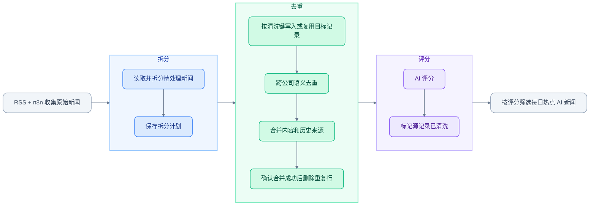

# AI 新闻自动清洗

在 **RSS + n8n** 收集原始新闻（raw news）后，通过本脚本完成 **拆分 → 去重 → 评分**，辅助筛选和产出每日热点 AI 新闻。

使用 Python、飞书多维表格和 DeepSeek，支持 GitHub Actions 每日运行，结果写回飞书。

## 工作流程



| 阶段 | 处理内容 |
| --- | --- |
| 拆分 | 将日报、周报等合集拆成独立新闻，补全公司与分类 |
| 去重 | 识别同一事件，合并摘要与来源链接，删除重复记录 |
| 评分 | 按新闻价值评为 1–5 分，供后续筛选热点 |

## 快速开始

### 1. 准备表格与密钥

需要 **Python 3.11+**、**DeepSeek API Key**，以及飞书应用可访问的源表和目标表。

先按 [表格配置指南](docs/configuration.md#配置表格) 创建字段，包含用于中断恢复的辅助字段；目标表的“评分”须为数字类型。

### 2. 安装与配置

```bash
python3 -m venv .venv
source .venv/bin/activate
python -m pip install -r requirements.txt
cp .env.example .env
```

编辑 `.env`，填写飞书应用凭据、源表与目标表 ID，以及 DeepSeek API Key。完整变量说明见 [配置指南](docs/configuration.md#本地运行)。

### 3. 运行

在 bash / zsh 中加载配置并启动：

```bash
set -a
source .env
set +a
python main.py
```

> 当前已通过离线测试，尚未完成真实表格联调。首次运行请使用有效配置和副本表；原代码中曾明文保存的应用密钥需先更换。

## 每日自动运行

默认每天 **北京时间 09:17（UTC 01:17）** 执行完整流程。

1. 将代码上传到 GitHub 仓库的默认分支。
2. 在 **Settings → Secrets and variables → Actions** 添加 `.env.example` 中的 6 个必填密钥配置。
3. 在 **Actions → Daily news cleaning → Run workflow** 手动运行一次，确认结果。

运行时间在 [daily-clean.yml](.github/workflows/daily-clean.yml) 中调整。Lark 地址、回溯窗口及调度注意事项见 [自动运行配置](docs/configuration.md#github-每日自动运行)。

## 测试与维护

```bash
python -m unittest discover -s tests -v
```

离线测试不需要密钥，也不调用真实服务。失败后可重跑，程序通过保存的计划和清洗键恢复进度；请勿同时从多个环境运行同一张表。

| 想要了解或调整 | 查看位置 |
| --- | --- |
| 分类与评分规则 | [editorial.py](editorial.py) |
| 字段、环境变量与部署 | [配置指南](docs/configuration.md) |
| 失败重试、数据迁移与处理上限 | [中断恢复与限制](docs/configuration.md#中断恢复与限制) |
| 模块职责 | [项目结构](docs/configuration.md#项目结构) |

密钥和本地历史数据已通过 `.gitignore` 排除，不随正常 Git 提交上传。
